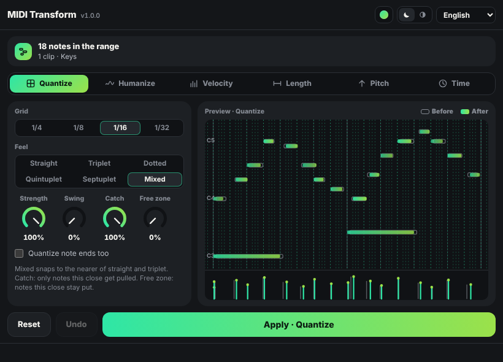
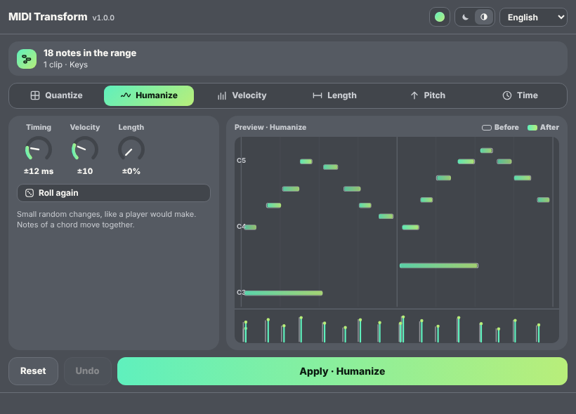

# MIDI Transform for LUNA

Quantize, humanize, velocity, length, pitch and time tools for the MIDI notes you select in
LUNA, with a before and after preview. Pick a tool, adjust it while you watch the preview, and
press Apply: one undo step, and the notes stay selected for the next tool.

  
  

## Features

- **Works on what you select:** the notes selected in LUNA's editor, or every note that starts
  inside a selected range of MIDI clips, on one or more tracks.
- **Quantize:** 1/4 to 1/32 in six feels: straight, triplet, dotted, quintuplet, septuplet, or
  mixed (each note goes to the nearer of the straight and the triplet grid). Strength below 100%
  keeps part of the feel, swing pushes every other step, catch only pulls notes that are already
  close, the free zone leaves notes that are close enough alone, and note ends can be quantized
  too.
- **Humanize:** small random changes to timing (in milliseconds, following the tempo),
  velocity and length. Notes of a chord move together. Roll again for another take.
- **Velocity:** squeeze or spread the dynamics around their average and add an offset, set a
  fixed value, or draw a crescendo or decrescendo with a curve.
- **Length:** legato (each note lasts until the next one starts, with an optional gap), a fixed
  length, or a percentage.
- **Pitch:** transpose by semitones and octaves; force the notes to a scale (major, minor,
  harmonic minor, dorian, mixolydian, both pentatonics, blues), with the key read from LUNA;
  or invert the melody around its lowest note, its centre or its highest note.
- **Time:** reverse, double speed, half speed or shift by grid steps. When notes need more room,
  the clip grows up to the next bar line if the lane is free.
- **Before and after:** a small piano roll shows the original notes outlined and the result in
  colour, with a velocity lane underneath.
- **Safe:** each Apply is one undo step (or use the Undo button), selected notes stay selected,
  and muted notes stay muted.
- **Your colour:** yellow, orange, red, green, blue, pink or purple; dark and grey themes.
- **7 languages:** English, Español, Català, Français, Deutsch, Italiano and Português.

## How to use it

1. In LUNA, select some notes in a MIDI clip, or select a range over MIDI clips.
2. In **MIDI Transform**, pick a tool and adjust it while you watch the preview.
3. Press **Apply** (or Enter). Undo with Cmd+Z in LUNA or the **Undo** button.

## Support

If something does not work as expected, Alt-click the version number at the top of the window:
it copies a short report to paste in a message to fedetrillo@gmail.com.

## Install

Requires LUNA 3.1.2 or later. Install it from LUNA's Add On marketplace, or download
`miditransform.lunaaddon` from the latest release and double-click it. Then open a session and
choose **Add Ons > Windows > MIDI Transform**.

## En español

Herramientas para las notas MIDI que seleccionas en LUNA: cuantizar, humanizar, velocidad,
duración, altura y tiempo, con vista previa de antes y después. Cada Aplicar es un solo paso de
deshacer y las notas siguen seleccionadas para la siguiente herramienta. Modo oscuro y gris,
siete colores, 7 idiomas.

## Licence

Copyright (c) 2026 Fede Trillo. All rights reserved. Free to install and use in LUNA; the code
may not be copied, modified or redistributed. See [LICENSE](LICENSE). The bundled LUNA Builder
SDK is Universal Audio's, under the Apache License 2.0: see
[THIRD_PARTY_NOTICES.md](THIRD_PARTY_NOTICES.md).

Contact: fedetrillo@gmail.com
